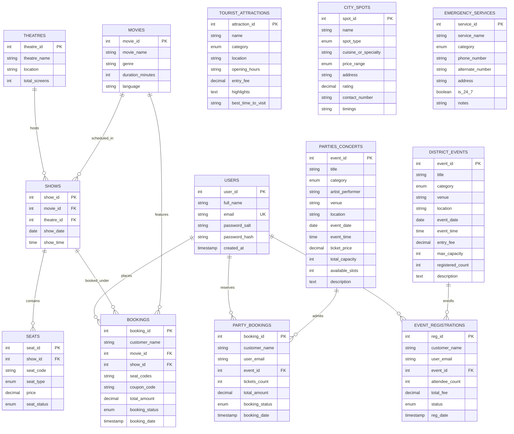

<h1 align="center">TownTrek: Unified Urban Exploration & Booking Platform</h1>

<p align="center">
  <b>The modern, console-native urban companion for discovering cinema screenings, live concerts, workshops, cultural landmarks, culinary spots, and 24/7 public emergency services.</b>
</p>

> ✨ **TownTrek v1.0** — High-performance, multi-domain city discovery and reservation engine engineered with **Java 17 LTS, JDBC, MySQL 8, and Apache Maven**. Features real-time 5×8 cinema seating matrices, multi-pass concert ticketing, workshop RSVP counters, curated culinary directories, cryptographic salt-and-hash authentication, and centralized cross-domain pass cancellations.

<p align="center">
  
</p>

<p align="center">
  <a href="#-what-is-towntrek">About TownTrek</a> ·
  <a href="#-product-tour">Product Tour</a> ·
  <a href="#-core-modules--feature-deep-dive">Core Modules</a> ·
  <a href="#-system-architecture">Architecture</a> ·
  <a href="#-database-schema--relational-design">Database Schema</a> ·
  <a href="#-terminal-ui-experience">Terminal UI</a> ·
  <a href="#-quick-start-guide">Quick Start</a> ·
  <a href="#-roadmap">Roadmap</a>
</p>

<p align="center">
  <a href="https://www.oracle.com/java/technologies/javase/jdk17-archive-downloads.html"></a>
  <a href="https://www.mysql.com/"></a>
  <a href="https://maven.apache.org/"></a>
  <a href="LICENSE"></a>
  <a href="#-quick-start-guide"></a>
  <a href="https://github.com/AravDakshZen/TownTrek/issues"></a>
</p>

---

## 🌟 What is TownTrek

**TownTrek** is an enterprise-grade, console-native urban exploration and booking platform crafted in modern **Java 17**. Built specifically for city dwellers, travelers, newcomers, and urban explorers, TownTrek unifies previously fragmented city services into one seamless, blazingly fast digital companion.

Traditional urban apps force users to juggle separate platforms for cinema tickets, nightlife gigs, community workshops, tourist sightseeing, restaurant reservations, and emergency assistance. **TownTrek solves this fragmentation** by providing a single, coherent ecosystem backed by robust relational data models, ACID-compliant transactions, and a clean, responsive terminal interface.

### Key Architectural Strengths

- 🎟️ **Unified Multi-Domain Pass Center**: Reserve cinema seats, concert wristbands, and workshop registrations under one unified account with instant cancellation and real-time inventory rollback.
- ⚡ **Zero-Overhead Raw JDBC Performance**: Uses direct SQL PreparedStatements with zero ORM overhead, delivering sub-millisecond query execution and complete transaction lifecycle transparency.
- 🔒 **Cryptographic Security by Design**: Passwords are never stored in plaintext; user authentication leverages CSPRNG salt generation combined with SHA-256 cryptographic hashing.
- 🗄️ **Relational Integrity Across 13 Normalized Tables**: Structured schema enforcing foreign key cascades, unique seating constraints, and automated audit timestamps.
- 🎛️ **Resilient Configuration Architecture**: 3-tier fallback engine supporting OS environment variables, local `.properties` files, and zero-configuration development defaults.

---

## 📸 Product Tour

<table width="100%">
<tr>
<td width="50%" valign="top">
  <br/>
  <sub><b>Cinema & Live Music Hub</b> — Interactive 5×8 seating grids with real-time availability states, concession add-ons, coupon discount engines, and multi-tier VIP concert ticketing.</sub>
</td>
<td width="50%" valign="top">
  <br/>
  <sub><b>Aesthetic Terminal UI</b> — Clean Unicode dividing rules, aligned tabular listings, instant input validation, and high-contrast matrix displays designed for power users.</sub>
</td>
</tr>
<tr>
<td width="50%" valign="top">
  <br/>
  <sub><b>Urban Landmarks & Dining Guide</b> — Curated tourist hotspots with operating hours and travel tips, 5-star culinary spots with price indicators (₹ to ₹₹₹₹), and 24/7 emergency dispatch contacts.</sub>
</td>
<td width="50%" valign="top">
  <br/>
  <sub><b>Unified City Ecosystem</b> — Cross-domain search, synchronized user profiles, ticket verification passes with unique confirmation alphanumeric codes, and automated seat releases.</sub>
</td>
</tr>
</table>

---

## ⚡ Platform Compatibility

TownTrek is engineered for maximum portability across any workstation or server supporting Java 17 and a standard SQL gateway.

| Platform / Environment | Compatibility | Execution Method | Notes |
|:---|:---:|:---|:---|
| **Windows 10 / 11** | ✅ Certified | PowerShell / Windows Terminal | Full ANSI color & UTF-8 character support |
| **macOS (Apple Silicon & Intel)** | ✅ Certified | zsh / bash / iTerm2 | Zero native dependency overhead |
| **Linux (Ubuntu, Debian, Fedora, Arch)** | ✅ Certified | bash / zsh / tmux | Perfect for headless servers & SSH exploration |
| **MySQL 8.0 / 8.4 LTS** | ✅ Certified | Local Daemon / Remote Host | Full ACID transactional enforcement |
| **MariaDB 10.6+** | ✅ Compatible | JDBC Connector/J | Compatible syntax & data types |
| **Docker Engine** | ✅ Ready | `docker-compose` / Containerized MySQL | Instant isolated database deployment |

---

## 🎯 Core Modules & Feature Deep Dive

TownTrek divides urban living into **8 comprehensive modules**, each powered by dedicated DAOs, services, and models.

```
                    ┌──────────────────────────────────────────────┐
                    │            TOWNTREK MAIN SYSTEM              │
                    └──────┬────────────────────────────────┬──────┘
                           │                                │
            ┌──────────────┴──────────────┐  ┌──────────────┴──────────────┐
            │   Entertainment & Leisure   │  │   Exploration & Safety      │
            ├─────────────────────────────┤  ├─────────────────────────────┤
            │ 1. Cinema & Movie Booking   │  │ 4. Tourist Attractions      │
            │ 2. Parties & Live Concerts  │  │ 5. Dining & Shopping Spots  │
            │ 3. Workshops & City Events  │  │ 6. 24/7 Emergency Helplines │
            └─────────────────────────────┘  └─────────────────────────────┘
                           │                                │
            ┌──────────────┴──────────────┐  ┌──────────────┴──────────────┐
            │ 7. Unified Pass Management  │  │ 8. Global Smart City Search │
            └─────────────────────────────┘  └─────────────────────────────┘
```

### 1. Cinema & Movie Reservation Engine
- **Film Discovery**: Filter by title, genre (Sci-Fi, Action, Drama, Thriller), language, and duration.
- **Interactive 5 × 8 Seating Matrix**:
  - `[O]` indicates available seats.
  - `[X]` indicates reserved / occupied seats.
  - Supports batch multi-seat booking (e.g., `A1, A2, B5`).
- **Concessions & Refreshments**: Optional add-ons including Caramel Popcorn, Nachos with Salsa, and Beverage Combos.
- **Coupon Engine**: Apply dynamic promo codes such as `CINE10` for an immediate 10% discount on cart totals.
- **Seat Conflict Prevention**: Database transactions ensure no two concurrent explorers can claim the same seat code for a given showtime.

### 2. Nightlife, Parties & Live Concerts
- **Dynamic Categories**: Curated DJ Club Parties, Arena Concerts, and Standup Comedy specials.
- **Artist & Performer Profiles**: Detailed artist bios, venue locations, and showtimes.
- **Live Capacity Management**: Real-time decrementation of `available_slots`; prevents overselling beyond venue capacity.
- **Multi-Pass Bookings**: Generate verified booking passes with attendee counts and total billing breakdown.

### 3. Workshops & Community Events
- **Hands-on Learning & Culture**: Pottery sessions, AI/Tech bootcamps, urban gardening, food carnivals, and cultural galas.
- **Group RSVP System**: Register multiple attendees in a single transaction with automatic fee computation.
- **Capacity Gates**: Automatically marks events as `FULL` once registered headcounts hit venue limits.

### 4. Tourist Landmarks & City Heritage
- **Rich Heritage Compendium**: Historic citadels, Gothic cathedrals, seaside promenades, natural gardens, and museums.
- **Actionable Visitor Guides**: Exact operating hours, entry fee schedules, highlights, and recommended visiting windows (e.g., sunrise, golden hour).

### 5. Dining & Shopping Centres
- **Curated City Havens**: Fine-dining bistros, specialty rooftop cafes, street food markets, and luxury retail malls.
- **Crucial Spot Metrics**: Price index (`₹` budget to `₹₹₹₹` luxury), star ratings (e.g., `★ 4.8`), complete street addresses, opening hours, and direct telephone lines.

### 6. 24/7 Public Services & Emergency Helplines
- **Immediate Rapid Dispatch**: Direct access to national emergency lines:
  - `112` — Unified Emergency Dispatch
  - `100` — Police Rapid Response
  - `108` — Emergency Medical & Ambulance Squad
  - `101` — Fire & Rescue Services
  - `1091` — Women's Safety Helpline
- **Critical Facilities**: Mapped hospital trauma centres, round-the-clock pharmacies, and transit authorities with 24/7 status flags.

### 7. Unified Pass Dashboard & Cancellation Portal
- **Consolidated Booking Vault**: Review all historical and upcoming passes across movies, concerts, and workshops in one unified screen.
- **Atomic Cancellation Engine**:
  - Cancelling a cinema pass instantly sets seat status back to `AVAILABLE`.
  - Cancelling a concert or workshop pass restores available capacity slots to the pool.
  - Updates booking status to `CANCELLED` while maintaining an immutable audit log.

### 8. Global Smart City Search
- **Instant Full-Text Search**: Query any keyword across all tables simultaneously to uncover matching attractions, movies, shows, food spots, and upcoming events.

---

## 🏗️ System Architecture

TownTrek follows an enterprise 4-tier layered architecture adhering to the **Separation of Concerns (SoC)** and **Data Access Object (DAO)** patterns:

```
┌────────────────────────────────────────────────────────────────────────┐
│                        TOWNTREK TERMINAL UI                            │
│           Main.java · InputHelper · SessionState Management            │
└───────────────────────────────────┬────────────────────────────────────┘
                                    │ Method Calls & User Input
                                    ▼
┌────────────────────────────────────────────────────────────────────────┐
│                           SERVICE LAYER                                │
│    BookingService · PartyConcertService · DistrictEventService         │
│          DistrictGuideService · UnifiedBookingService                  │
└───────────────────────────────────┬────────────────────────────────────┘
                                    │ Business Logic & Data Validation
                                    ▼
┌────────────────────────────────────────────────────────────────────────┐
│                   DATA ACCESS OBJECT (DAO) LAYER                       │
│    AuthDAO · MovieDAO · ShowDAO · SeatDAO · BookingDAO                 │
│    PartyConcertDAO · DistrictEventDAO · TouristAttractionDAO           │
│    CitySpotDAO · EmergencyServiceDAO                                   │
└───────────────────────────────────┬────────────────────────────────────┘
                                    │ PreparedStatements & Parameter Mapping
                                    ▼
┌────────────────────────────────────────────────────────────────────────┐
│                 DBCONNECTION MANAGER & POOL ENGINE                     │
│    Environment Variables ──► db.properties ──► Hardcoded Fallback      │
└───────────────────────────────────┬────────────────────────────────────┘
                                    │ JDBC Connection (mysql-connector-j)
                                    ▼
┌────────────────────────────────────────────────────────────────────────┐
│                      MYSQL 8 RELATIONAL DATABASE                       │
│    13 Normalized Tables · Foreign Key Cascades · ACID Transactions     │
└────────────────────────────────────────────────────────────────────────┘
```

### Architectural Principles

| Layer | Responsibility | Key Classes |
|:---|:---|:---|
| **UI Presentation** | Renders ASCII menus, tables, banners, and handles sanitized user input | `Main.java`, `InputHelper.java` |
| **Service Logic** | Orchestrates workflows, calculates discounts, computes seat pricing, and handles cancellations | `BookingService`, `UnifiedBookingService`, `DistrictEventService`, `PartyConcertService`, `DistrictGuideService` |
| **Data Access (DAO)** | Isolates SQL queries, prevents SQL injection via `PreparedStatement`, manages result set mapping | `AuthDAO`, `BookingDAO`, `SeatDAO`, `ShowDAO`, `MovieDAO`, `PartyConcertDAO`, `DistrictEventDAO`, `CitySpotDAO`, etc. |
| **Persistence & Config** | Manages JDBC connection pooling, graceful connection closure, and environment resolution | `DBConnection.java`, `db.properties` |

---

## 🗄️ Database Schema & Relational Design

The TownTrek relational database (`movie_booking_db`) consists of **13 carefully normalized tables** designed for referential integrity:



---

## 🖥️ Terminal UI Experience

TownTrek features a modern, polished command-line aesthetic designed to elevate the terminal experience:

### 1. Main Navigation Hub

```text
____________________________________________________________________________________
                                TOWNTREK MAIN HUB
____________________________________________________________________________________
 Active User : Aravindh Murugesh (arav@district.com)
 Location    : Metropolitan Central Hub
____________________________________________________________________________________
  1. Movies & Cinema             Browse movies, cinemas, seat maps & book tickets
  2. Parties & Live Concerts     Discover DJ nights, music fests & comedy shows
  3. Nearby Events & Workshops   Register for workshops, food fests & sports
  4. Tourist Attractions         Explore monuments, beaches, museums & nature parks
  5. Dining & Shopping Centres   Locate top restaurants, cafes, markets & malls
  6. Emergency & Public Services 24/7 Police, trauma care, ambulance & civic helplines
  7. My Passes & Bookings        Unified ticket dashboard & cancellations
  8. City Quick Search           Find spots, events, or movies by keyword
  0. Sign Out / Exit
____________________________________________________________________________________
```

### 2. Interactive Cinema Auditorium Seat Map

```text
____________________________________________________________________________________
                        TOWNTREK CINEMA AUDITORIUM SCREEN
____________________________________________________________________________________
  [Screen Stage Front]
  
  Row A:  [O] A1   [O] A2   [X] A3   [X] A4   [O] A5   [O] A6   [O] A7   [O] A8
  Row B:  [O] B1   [O] B2   [O] B3   [O] B4   [X] B5   [X] B6   [O] B7   [O] B8
  Row C:  [O] C1   [O] C2   [O] C3   [O] C4   [O] C5   [O] C6   [O] C7   [O] C8
  Row D:  [O] D1   [O] D2   [X] D3   [X] D4   [X] D5   [O] D6   [O] D7   [O] D8
  Row E:  [O] E1   [O] E2   [O] E3   [O] E4   [O] E5   [O] E6   [O] E7   [O] E8
  
  Legend: [O] Available    [X] Booked
____________________________________________________________________________________
```

### 3. Generated TownTrek Booking Pass

```text
____________________________________________________________________________________
                              TOWNTREK VERIFIED PASS
____________________________________________________________________________________
  Pass ID        : #TT-BK-2026-9041
  Holder Name    : Aravindh Murugesh
  Event / Film   : Interstellar: Beyond Horizon (Sci-Fi)
  Venue          : PVR Grand Luxe Multiplex (Screen 2)
  Seats Reserved : [ A1, A2 ] (2 Seats)
  Total Paid     : ₹ 630.00 (Coupon Applied: CINE10)
  Status         : CONFIRMED
____________________________________________________________________________________
```

---

## 🚀 Quick Start Guide

Get TownTrek up and running in **under 2 minutes** with these simple steps.

### Prerequisites

Ensure you have the following installed on your machine:
- **Java Development Kit (JDK) 17+** (`java -version`)
- **Apache Maven 3.8+** (`mvn -version`)
- **MySQL Server 8.0+** running locally or in Docker (`mysql --version`)

---

### Step 1: Run the One-Step Database Migration

TownTrek includes a complete, idempotent database migration script containing the full schema and rich sample datasets:

```bash
# Clone the repository
git clone https://github.com/AravDakshZen/TownTrek.git
cd TownTrek

# Execute the complete migration script
mysql -u root -p < database/migration_district_towntrek.sql
```

> **What this script does:**
> - Automatically creates the `movie_booking_db` database.
> - Establishes all 13 relational tables with primary keys, indexes, and foreign keys.
> - Seeds rich realistic records across all categories (theatres, films, shows, concerts, workshops, landmarks, restaurants, and emergency contacts).
> - Creates default test accounts with salted hashes ready for immediate login.

---

### Step 2: Configure Database Credentials

TownTrek automatically discovers your database credentials using a 3-tier precedence engine:

#### Option A: Environment Variables (Recommended for CI/CD & Production)
```powershell
# Windows PowerShell
$env:DB_USER = "root"
$env:DB_PASSWORD = "your_mysql_password"
$env:DB_URL = "jdbc:mysql://localhost:3306/movie_booking_db?useSSL=false&allowPublicKeyRetrieval=true&serverTimezone=UTC"
```
```bash
# macOS / Linux (bash/zsh)
export DB_USER="root"
export DB_PASSWORD="your_mysql_password"
export DB_URL="jdbc:mysql://localhost:3306/movie_booking_db?useSSL=false&allowPublicKeyRetrieval=true&serverTimezone=UTC"
```

#### Option B: Local Properties File
Copy the example properties file and supply your credentials:
```bash
cp db.properties.example db.properties
```
Edit `db.properties`:
```properties
db.url=jdbc:mysql://localhost:3306/movie_booking_db?useSSL=false&allowPublicKeyRetrieval=true&serverTimezone=UTC
db.user=root
db.password=your_mysql_password
```

#### Option C: Default Fallback
If neither is specified, TownTrek defaults to `localhost:3306/movie_booking_db` with user `root` and a blank password.

---

### Step 3: Build & Launch TownTrek

Compile and launch the console application using Maven:

```bash
mvn clean compile
mvn exec:java
```

---

### 🔑 Test User Credentials

You can create a new account in the app or log in with the pre-seeded demo user:

| Email | Password | Role | Features Available |
|:---|:---|:---|:---|
| `arav@district.com` | `password123` | Verified Resident | All 8 Modules & Full Booking Rights |

---

## 📂 Project Structure

```text
TownTrek/
├── .gitignore
├── pom.xml                               # Maven project descriptor & dependencies
├── README.md                             # Comprehensive TownTrek documentation
├── db.properties.example                 # Configuration template
├── assets/                               # Visual documentation assets & banners
│   ├── towntrek-hero.jpg                 # Hero branding banner
│   ├── towntrek-cinema-concert.jpg       # Cinema and music concert UI showcase
│   ├── towntrek-city-exploration.jpg     # Landmarks and dining guide showcase
│   └── towntrek-terminal-ui.jpg          # High-fidelity CLI terminal showcase
├── database/                             # Database migrations and seed datasets
│   ├── migration_district_towntrek.sql   # Unified migration script (schema + data)
│   ├── schema.sql                        # Base relational DDL schema
│   └── sample_data.sql                   # Additional seed records
└── src/
    └── main/
        └── java/
            └── com/
                └── moviebooking/
                    ├── Main.java         # Interactive CLI application & menus
                    ├── config/
                    │   └── DBConnection.java     # JDBC connection lifecycle & config
                    ├── dao/                      # Data Access Objects (Raw SQL)
                    │   ├── AuthDAO.java
                    │   ├── BookingDAO.java
                    │   ├── CitySpotDAO.java
                    │   ├── DistrictEventDAO.java
                    │   ├── EmergencyServiceDAO.java
                    │   ├── MovieDAO.java
                    │   ├── PartyConcertDAO.java
                    │   ├── SeatDAO.java
                    │   ├── ShowDAO.java
                    │   └── TouristAttractionDAO.java
                    ├── model/                    # Domain POJOs
                    │   ├── Booking.java
                    │   ├── CitySpot.java
                    │   ├── DistrictEvent.java
                    │   ├── EmergencyService.java
                    │   ├── EventRegistration.java
                    │   ├── Movie.java
                    │   ├── MovieBookingDetail.java
                    │   ├── PartyBooking.java
                    │   ├── PartyConcert.java
                    │   ├── Seat.java
                    │   ├── Show.java
                    │   ├── TouristAttraction.java
                    │   └── UserAccount.java
                    ├── service/                  # Business logic services
                    │   ├── BookingService.java
                    │   ├── DistrictEventService.java
                    │   ├── DistrictGuideService.java
                    │   ├── PartyConcertService.java
                    │   └── UnifiedBookingService.java
                    └── util/
                        └── InputHelper.java      # Terminal input sanitization
```

---

## 🗺️ Roadmap 

- [x] **v1.0 — Core Foundation**
  - [x] Full Java 17 + JDBC + MySQL 8 integration
  - [x] Salted SHA-256 password security engine
  - [x] Interactive 5×8 cinema seating matrix with seat lock logic
  - [x] Live nightlife, party, and concert booking system
  - [x] Community workshops, food fests, and cultural registrations
  - [x] Comprehensive tourist guides and landmark directories
  - [x] Curated dining and shopping directory with ratings and pricing
  - [x] 24/7 public emergency and trauma hotline directory
  - [x] Unified pass manager with cross-module cancellation
  - [x] Global keyword search across all 13 domains

---

## 🤝 Contributing

Contributions make open-source projects thrive! To contribute to TownTrek:

1. **Fork the Repository** on GitHub.
2. **Create a Feature Branch** (`git checkout -b feature/NewAwesomeFeature`).
3. **Commit Your Changes** with descriptive messages (`git commit -m 'Add NewAwesomeFeature'`).
4. **Push to the Branch** (`git push origin feature/NewAwesomeFeature`).
5. **Open a Pull Request** explaining your enhancements.

Please ensure all new code compiles cleanly with `mvn clean compile` and follows clean code practices with proper resource cleanup (`try-with-resources`).

---

## 📄 License

TownTrek is open-source software licensed under the **MIT License**. See the [LICENSE](LICENSE) file for details.

---

<p align="center">
  <b>Built with ❤️ for urban explorers and city enthusiasts.</b><br/>
  <sub>TownTrek — One City, Infinite Adventures.</sub>
</p>
